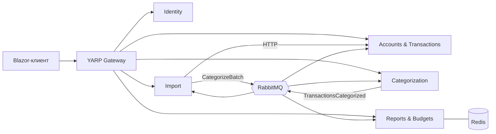

# Личные финансы и аналитика

[](https://github.com/juggernator13/finance-tracker/actions/workflows/ci.yml)

Система для учёта личных финансов на микросервисах. Можно вести счета и операции, загружать банковские выписки в CSV, операции сами раскладываются по категориям, по ним строятся отчёты, а на категории можно задать бюджеты.

## Технологический стек

- .NET 9, ASP.NET Core, EF Core
- PostgreSQL 16 (своя БД у каждого сервиса)
- RabbitMQ (собственная библиотека `Finance.Messaging` поверх RabbitMQ.Client), Redis
- YARP (API Gateway), JWT, BCrypt
- Blazor Server (веб-клиент)
- Serilog, Swagger
- Docker, Docker Compose, GitHub Actions
- xUnit, EF Core InMemory, k6 (нагрузочный тест)

## Архитектура

Пять сервисов за одним Gateway: Identity, Accounts & Transactions, Import, Categorization, Reports & Budgets. Клиент работает только через Gateway, который проверяет JWT. Импорт выписки: Import разбирает файл и создаёт операции в Accounts по HTTP, затем через RabbitMQ идёт категоризация, после чего проставляются категории операций, обновляются отчёты и проверяются бюджеты. Отчёт по категориям кэшируется в Redis.



Подробнее: [docs/ARCHITECTURE.md](docs/ARCHITECTURE.md) (сервисы, модель данных, диаграмма импорта, ADR).

## Быстрый старт

Нужны Docker и Docker Compose (для запуска тестов ещё .NET SDK 9.0).

```bash
git clone https://github.com/juggernator13/finance-tracker.git
cd finance-tracker
cp .env.example .env        # в Windows: copy .env.example .env
docker compose up --build
```

Значения в `.env.example` подходят для локального запуска. Для чего-либо кроме разработки замените `JWT_SIGNING_KEY` и пароли. Файл `.env` в репозиторий не попадает.

Адреса после запуска:

| Что | Адрес |
|-----|-------|
| Веб-клиент | http://localhost:5004 |
| Gateway | http://localhost:5000 |
| Swagger сервисов | http://localhost:5001/swagger (Identity), 5002 (Accounts), 5003 (Import), 5005 (Categorization), 5006 (Reports) |
| RabbitMQ (панель) | http://localhost:15672 |
| Redis | localhost:6379 |
| PostgreSQL | порты 5433–5437, по одной БД на сервис |

Тестовые учётные записи (создаются при первом запуске):

| Роль | Email | Пароль |
|------|-------|--------|
| User | user@example.com | User123! |
| Admin | admin@example.com | Admin123! |

Как попробовать: войти в клиенте, создать счёт, на странице «Импорт» загрузить `samples/bank1.csv` (или `samples/bank2.csv`), затем открыть «Отчёты». Повторная загрузка того же файла в тот же счёт дубли не создаёт.

Остановка: `docker compose down` (с флагом `-v` ещё и удаляет данные БД).

## Функциональность

Обязательный минимум:
- [x] Регистрация, вход, JWT, refresh-токены, роли User и Admin
- [x] Счета и операции (создание, просмотр, изменение, удаление), пользователь видит только свои данные
- [x] Импорт CSV двух форматов банков, защита от дублей
- [x] Веб-клиент: вход, счета, операции, импорт, отчёты
- [x] Автотесты, README, ARCHITECTURE, PLAN, история коммитов

Средний уровень:
- [x] API Gateway (YARP)
- [x] Обмен событиями через RabbitMQ
- [x] Автокатегоризация по правилам (подстрока или регулярное выражение, приоритеты, общие и личные правила)
- [x] Бюджеты на категории, событие `BudgetExceeded` при превышении
- [x] Отчёты по категориям за месяц и по месяцам за год
- [x] Запуск одной командой `docker compose up --build`
- [x] CI на GitHub Actions

Продвинутый уровень:
- [x] Кэширование отчётов в Redis
- [x] Нагрузочный тест (k6)
- [x] ADR в архитектурном документе
- [ ] Outbox или Saga
- [ ] SignalR
- [ ] Интеграционные тесты
- [ ] Прогноз расходов и повторяющиеся платежи (из задания темы)

## Тесты и CI

171 автоматических тестов (xUnit, EF Core InMemory, заглушки HTTP-клиентов и шины сообщений).

```bash
dotnet test
```

CI (`.github/workflows/ci.yml`) на каждый push в `main` и Pull Request собирает решение в Release и запускает тесты, результаты сохраняются артефактом `test-results`.

Нагрузочный тест: скрипт k6 `tests/load/report.js`, результаты до и после Redis в `tests/load/baseline.json` и `tests/load/with-redis.json`, методика и выводы в [docs/LOAD_TEST.md](docs/LOAD_TEST.md). При 50 виртуальных пользователях система держит около 405 запросов в секунду, p(95) около 5 мс, ошибок нет. Redis на таком объёме данных заметного ускорения не дал.

## Структура репозитория

```
.
├── src/
│   ├── BuildingBlocks/        Finance.Common, Finance.Contracts, Finance.Messaging
│   ├── Gateway/               Finance.Gateway (YARP)
│   ├── Services/              Identity, AccountsTransactions, Import, Categorization, ReportsBudgets
│   └── Clients/Finance.Web/   Blazor Server
├── tests/                     тесты сервисов и библиотек, tests/load (k6)
├── samples/                   примеры выписок bank1.csv и bank2.csv
├── docs/                      PLAN.md, ARCHITECTURE.md, LOAD_TEST.md
├── docker-compose.yml
├── .env.example
└── .github/workflows/ci.yml
```

## План работ

Этапы с плановыми и фактическими датами, риски и журнал изменений: [docs/PLAN.md](docs/PLAN.md).

## Использование ИИ

При работе над проектом я использовал ИИ-ассистента Claude: пошаговые планы реализации, помощь с разбором ошибок по логам и скриншотам, подготовка документации, написание unit-тестов.

## Ограничения

- Нет Outbox, Saga и защиты от повторной доставки сообщений. Если сбой произойдёт между созданием операций и отправкой сообщения, импорт получит статус `Failed`, а операции останутся без категорий (автоотката нет).
- Событие `BudgetExceeded` публикуется, но пользователю не доставляется (SignalR не реализован). Статус импорта в клиенте обновляется только после перезагрузки страницы.
- В клиенте нет страниц бюджетов, категорий и правил, с ними можно работать через Swagger.
- Внутренние эндпоинты Accounts (`/internal/...`) без токена, защищены только тем, что доступны внутри сети Docker.
- Интеграционных тестов нет, сквозные сценарии проверялись вручную через Compose.
- Нет прогноза расходов и поиска повторяющихся платежей.
- Один экземпляр RabbitMQ и Redis, общий ключ JWT без ротации.

Полный список: [docs/ARCHITECTURE.md](docs/ARCHITECTURE.md), раздел 10.
