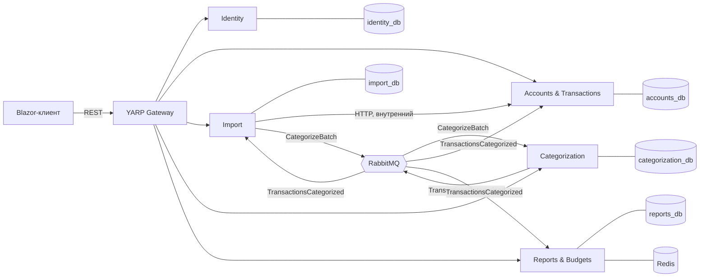
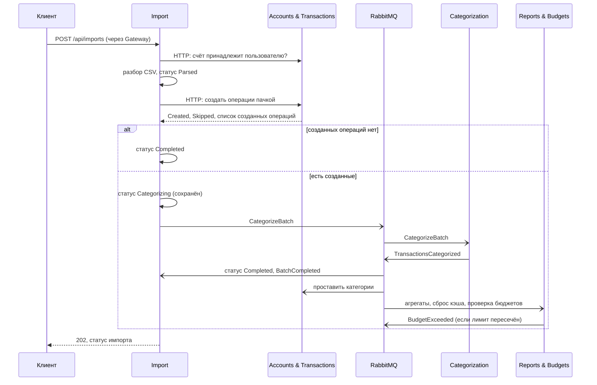

# Архитектура системы

Документ описывает фактическое состояние проекта на 13.11.2026. Первоначальный замысел (Saga, Outbox, SignalR, идемпотентные обработчики) реализован не был, что именно не сделано и почему, описано в разделах 9 и 10.

## 1. Цель и контекст

Система для учёта личных финансов. Пользователь ведёт счета и операции, загружает банковские выписки в CSV разных форматов, операции сами раскладываются по категориям по правилам, можно задать бюджеты на категории и смотреть отчёты по категориям и месяцам.

Пользователи: User (работает со своими данными) и Admin (управляет ролями пользователей).

Основные сценарии:
1. Регистрация и вход.
2. Создание счёта, ручной ввод и удаление операций.
3. Импорт выписки: загрузка CSV, создание операций, категоризация, пересчёт отчётов и проверка бюджетов.
4. Настройка категорий и правил, проверка правила на примере (`preview`).
5. Бюджеты на категории: при превышении лимита публикуется событие `BudgetExceeded`.
6. Отчёты по категориям за месяц и по месяцам за год.

## 2. Требования

- У каждого сервиса своя БД, в чужую БД никто не ходит.
- Повторная загрузка той же выписки не создаёт дублей операций и не удваивает суммы в отчётах.
- Сервисы обмениваются событиями через RabbitMQ, клиент работает только через Gateway.
- Вся система запускается командой `docker compose up --build`.
- Пользователь видит только свои данные.
- Отчёт по категориям кэшируется в Redis, при недоступности Redis отчёт всё равно строится из базы.

Нефункциональные результаты: нагрузочный тест (50 пользователей, около 405 запросов в секунду, p(95) около 5 мс, без ошибок) описан в [LOAD_TEST.md](LOAD_TEST.md).

## 3. Общая схема

Клиент обращается только к Gateway. Порты сервисов опубликованы на хосте только на `127.0.0.1` (для разработки и Swagger), маршрутов `/internal/...` в Gateway нет.

## 4. Описание сервисов

**Identity.** Регистрация, вход, JWT, refresh-токены, роли.
API: `POST /api/auth/register`, `/login`, `/refresh`, `/logout`; `GET /api/users/me`; для роли Admin `GET /api/users`, `PUT /api/users/{id}/role`.
БД `identity_db`: users, refresh_tokens. События не использует. При первом старте создаёт двух демонстрационных пользователей.

**Accounts & Transactions.** Счета и операции, защита от дублей по хэшу.
API: `/api/accounts` (список, создание, чтение, изменение, удаление), `GET` и `POST /api/accounts/{id}/transactions`, `PUT` и `DELETE /api/transactions/{id}`.
Внутренние эндпоинты (только для Import, через Gateway недоступны): `GET /internal/accounts/{id}?userId=` (проверка владельца счёта), `POST /internal/transactions/import` (создание пачки операций).
БД `accounts_db`: accounts, transactions.
Получает: `TransactionsCategorized` (проставляет категорию операциям пользователя). Публикует: ничего.

**Import.** Разбор CSV разных банков и управление импортом.
API: `POST /api/imports` (multipart: `accountId`, `format`, `file`), `GET /api/imports`, `GET /api/imports/{id}`, `GET /api/imports/formats`.
Форматы: bank1 (разделитель `;`, даты `дд.мм.гггг`, десятичная запятая, расходы со знаком минус) и bank2 (разделитель `,`, даты `гггг-мм-дд`, колонки Debit и Credit). Формат можно указать явно или он определяется по заголовку.
БД `import_db`: import_batches.
Получает: `TransactionsCategorized`, `CategorizationFailed`. Публикует: `CategorizeBatch`, `BatchCompleted` (на `BatchCompleted` пока никто не подписан).

**Categorization.** Категории, правила, автокатегоризация.
API: `/api/categories` (список, создание, удаление), `/api/rules` (список, создание, удаление), `POST /api/rules/preview` (какая категория выйдет для описания).
Правило: подстрока (без учёта регистра) или регулярное выражение, приоритет. Правила бывают общими (для всех) и личными (для пользователя). При равном приоритете личное правило сильнее общего. Если правил не нашлось, операция попадает в категорию «Прочее».
БД `categorization_db`: categories, rules. При старте создаются 7 общих категорий (Продукты, Транспорт, Кафе и рестораны, Жильё, Зарплата, Покупки, Прочее) и набор общих правил.
Получает: `CategorizeBatch`. Публикует: `TransactionsCategorized`, `CategorizationFailed`.

**Reports & Budgets.** Агрегаты, отчёты, бюджеты.
API: `/api/budgets` (список, создание, изменение, удаление), `GET /api/reports/by-category?year=&month=`, `GET /api/reports/monthly?year=`.
БД `reports_db`: budgets, monthly_totals. Кэш отчёта по категориям в Redis.
Получает: `TransactionsCategorized` (обновляет агрегаты, сбрасывает кэш, проверяет бюджеты). Публикует: `BudgetExceeded` один раз в момент, когда сумма расходов по категории пересекает лимит.

**Gateway (YARP).** Единая точка входа. Маршруты: `/api/auth/*` (без проверки токена), `/api/users/*`, `/api/accounts/*`, `/api/transactions/*`, `/api/imports/*`, `/api/categories/*`, `/api/rules/*`, `/api/reports/*`, `/api/budgets/*` (с проверкой JWT). Кластеры указывают на сервисы по именам в сети Docker.

**Веб-клиент (Blazor Server).** Страницы: вход, список счетов (создание), операции счёта (добавление, удаление), импорт (загрузка файла, история импортов), отчёты (по категориям за месяц и по месяцам за год). Токен хранится в памяти сессии. Бюджеты, категории и правила через клиент пока недоступны, с ними можно работать через Swagger сервисов.

**Общие библиотеки.** `Finance.Common` (JWT, Serilog, Swagger, промежуточные обработчики), `Finance.Contracts` (контракты сообщений), `Finance.Messaging` (клиент RabbitMQ).

## 5. Модель данных

| Сервис | Таблица | Поля |
|--------|---------|------|
| Identity | users | id, email, password_hash, role |
| Identity | refresh_tokens | id, user_id, token_hash, expires_at, revoked |
| Accounts & Transactions | accounts | id, user_id, name, currency |
| Accounts & Transactions | transactions | id, account_id, batch_id (пусто для ручных), date, amount, description, hash, category_id (пусто до категоризации) |
| Import | import_batches | id, user_id, account_id, format, status, total_rows, created, skipped, error, created_at |
| Categorization | categories | id, user_id (пусто у общих), name |
| Categorization | rules | id, user_id (пусто у общих), category_id, pattern, is_regex, priority |
| Reports & Budgets | budgets | id, user_id, category_id, category_name, limit |
| Reports & Budgets | monthly_totals | id, user_id, category_id, category_name, year, month, expense, income |

Связи между сервисами хранятся просто как идентификаторы, внешних ключей между БД нет. Соглашение о знаке суммы: расход отрицательный, доход положительный. В `monthly_totals` расход хранится как положительное число.

Статусы импорта: `Parsed` (файл разобран), `Categorizing` (операции созданы, ждём категоризацию), `Completed`, `Failed`.

## 6. Взаимодействие сервисов

Синхронно (HTTP): клиент → Gateway → сервис, а также Import → Accounts & Transactions (проверка владельца счёта и создание пачки операций).

Асинхронно (RabbitMQ), фактически используемые сообщения:

| Сообщение | Публикует | Получают |
|-----------|-----------|----------|
| `CategorizeBatch` (команда) | Import | Categorization |
| `TransactionsCategorized` | Categorization | Import, Accounts & Transactions, Reports & Budgets |
| `CategorizationFailed` | Categorization | Import |
| `BatchCompleted` | Import | никто (задел на будущее) |
| `BudgetExceeded` | Reports & Budgets | никто (задел на SignalR или другую доставку пользователю) |

В `Finance.Contracts` остались объявленные заранее, но не используемые сообщения: `CreateTransactions`, `TransactionsCreated`, `TransactionsCreationFailed`, `DeleteBatch`, `BatchDeleted`, `ImportStatusChanged`. Они относятся к отвергнутой схеме с Saga (см. ADR-3 и ADR-9).

### Импорт выписки

Порядок работы:
1. Import проверяет, что счёт принадлежит пользователю (HTTP к Accounts), разбирает файл выбранным парсером, присваивает порядковый номер повторяющимся строкам (две одинаковые строки в выписке считаются двумя операциями), сохраняет импорт со статусом `Parsed`.
2. Import отправляет пачку в Accounts (HTTP). Accounts считает хэш каждой операции, пропускает уже существующие и возвращает **только созданные** операции с их идентификаторами.
3. Если создано 0 операций, импорт сразу `Completed`. Иначе Import сохраняет статус `Categorizing` и только потом публикует `CategorizeBatch` с созданными операциями.
4. Categorization подбирает категорию по правилам (по приоритету), публикует `TransactionsCategorized` (или `CategorizationFailed` при ошибке).
5. Результат получают три сервиса: Import ставит `Completed`, Accounts проставляет `category_id` операциям (только счетов этого пользователя), Reports обновляет `monthly_totals`, сбрасывает кэш затронутых месяцев и публикует `BudgetExceeded`, если сумма расходов пересекла лимит.

Ошибки: сбой HTTP-вызова к Accounts, недоступность брокера при публикации и `CategorizationFailed` переводят импорт в статус `Failed` с текстом причины.

### Транспорт сообщений (Finance.Messaging)

- Обменник `finance` (direct), routing key = имя типа сообщения.
- Каждая подписка это отдельная устойчивая очередь `<сервис>.<Сообщение>` (например, `reports.TransactionsCategorized`), поэтому каждый получатель получает свою копию сообщения.
- Сообщения устойчивые (persistent), подтверждение вручную после успешной обработки, `prefetch = 1`.
- При ошибке обработчик вызывается до 3 раз (паузы 1 и 2 секунды), после этого сообщение уходит в очередь `finance.dead` через `finance.dlx`. Не читаемое сообщение сразу попадает в `finance.dead`.
- Формат: JSON (`JsonSerializerDefaults.Web`). Сквозной `X-Correlation-Id` передаётся в свойствах сообщения.

### Кэш (Redis)

Ключ `finance:report:{userId}:{год}:{месяц}`, значение: готовый отчёт по категориям (JSON), время жизни 5 минут. Схема cache-aside: чтение сначала из Redis, при отсутствии расчёт по `monthly_totals` и запись в кэш. Ключи месяцев, затронутых сообщением `TransactionsCategorized`, удаляются после обновления агрегатов. Все обращения к Redis обёрнуты в `try/catch`: при сбое кэша отчёт строится из базы.

## 7. Безопасность

- Пароли хранятся в виде хэша BCrypt.
- Access-токен JWT живёт 15 минут. Refresh-токены (7 дней) хранятся в БД в виде SHA-256 хэша, при выходе помечаются отозванными.
- Роли User и Admin. Admin нужен только для управления ролями пользователей в Identity, остальные операции доступны любому вошедшему пользователю и работают только с его данными (идентификатор пользователя берётся из токена, поле `sub`).
- JWT проверяется на Gateway и ещё раз в каждом сервисе (общий ключ подписи и издатель из переменных окружения).
- Маршрутов `/internal/...` в Gateway нет. Внутренние эндпоинты Accounts не требуют токена и защищены только тем, что сервисы доступны лишь внутри сети Docker (порты на хосте открыты только на `127.0.0.1`).
- Секреты берутся из переменных окружения. В репозитории только `.env.example` с заглушками, реальный `.env` в `.gitignore`.

## 8. Развёртывание и конфигурация

Запуск: `cp .env.example .env`, затем `docker compose up --build`. В Compose: по одной БД PostgreSQL 16.6 на сервис (5 штук, у каждой отдельный том), RabbitMQ 3.13.7 с панелью управления, Redis 7.4.1, 5 сервисов, Gateway и клиент. У баз, RabbitMQ и Redis есть health check, сервисы стартуют после готовности своих зависимостей.

Порты на хосте (все на `127.0.0.1`):

| Что | Порт |
|-----|------|
| Gateway | 5000 |
| Identity | 5001 |
| Accounts & Transactions | 5002 |
| Import | 5003 |
| Веб-клиент | 5004 |
| Categorization | 5005 |
| Reports & Budgets | 5006 |
| PostgreSQL: identity, accounts, import, categorization, reports | 5433, 5434, 5435, 5436, 5437 |
| RabbitMQ (AMQP, панель) | 5672, 15672 |
| Redis | 6379 |

Адреса сервисов друг для друга внутри Compose это имена сервисов и порт 8080 (`http://accounts:8080`, `rabbitmq`, `redis:6379`). Настройки передаются переменными окружения (`ConnectionStrings__Default`, `Jwt__*`, `RabbitMq__*`, `Redis__ConnectionString`, `Services__Gateway`, `Services__Accounts__BaseUrl`).

Также: логи через Serilog (Identity, Categorization, Reports и остальные сервисы), сквозной `X-Correlation-Id` (Gateway, Identity, Categorization, Reports), `/health` в сервисах и Gateway, Swagger у каждого сервиса (`/swagger` на порту сервиса), миграции EF Core при старте, начальные данные (тестовые пользователи и категории с правилами).

Тесты: 159 автоматических тестов (xUnit, EF Core InMemory, заглушки HTTP-клиента и шины сообщений), нагрузочный тест k6 в `tests/load`. CI: GitHub Actions на каждый push в `main` и Pull Request: сборка в Release, запуск тестов, результаты сохраняются артефактом `test-results`.

## 9. Принятые решения

**ADR-1. Собственная библиотека обмена сообщениями вместо MassTransit.**
Контекст: нужен RabbitMQ с очередями на получателя, повторами и очередью ошибок.
Решение: тонкая обёртка `Finance.Messaging` над RabbitMQ.Client (обменник, очереди `сервис.сообщение`, 3 попытки, очередь ошибок).
Альтернативы: MassTransit, Wolverine.
Причина: проще объяснить и показать, меньше скрытой логики, меньше зависимостей.
Последствия: больше кода и тестов, нет готовых Saga, Outbox и мониторинга, которые есть в MassTransit.

**ADR-2. Своя БД у каждого сервиса.**
Альтернатива: общая БД.
Причина: чёткие границы сервисов, этого требует задание.
Последствия: нет JOIN между сервисами. Данные, нужные другому сервису (имя категории, дата, сумма), передаются внутри сообщений и дублируются (`monthly_totals` хранит `category_name`).

**ADR-3. Import по очереди: HTTP к Accounts для создания операций, события только для категоризации.**
Контекст: сначала планировалась схема целиком на сообщениях (`CreateTransactions` → `TransactionsCreated` → `CategorizeBatch` и так далее).
Решение: Import вызывает Accounts по HTTP (проверка счёта и создание пачки) и получает в ответе созданные операции с идентификаторами. Дальше события: `CategorizeBatch` → `TransactionsCategorized`.
Альтернатива: полностью асинхронная схема с командой `CreateTransactions`.
Причина: Import должен сразу отказать пользователю, если счёт чужой, а не обнаружить это в середине процесса. Идентификаторы созданных операций нужны для категоризации, HTTP-ответ их даёт напрямую. Экономия около 1,5 дня при том, что требование «обмен событиями через RabbitMQ» выполняется (категоризация, агрегаты, категории в Accounts).
Последствия: Import зависит от доступности Accounts на момент загрузки. Контракты асинхронной схемы остались в `Finance.Contracts` неиспользованными.

**ADR-4. В категоризацию идут только созданные операции.**
Решение: Accounts возвращает только реально созданные операции (дубли пропущены), Import передаёт в `CategorizeBatch` именно их.
Причина: повторная загрузка файла не должна удваивать суммы в отчётах. Reports складывает суммы из каждого `TransactionsCategorized`, поэтому дубли в нём недопустимы.
Последствия: `Created` и `Skipped` Import берёт из ответа Accounts. Если все строки оказались дублями, категоризация не запускается и импорт сразу `Completed`.

**ADR-5. Дедупликация по хэшу операции.**
Решение: SHA-256 от (счёт, дата, сумма, описание, порядковый номер среди одинаковых строк выписки).
Альтернативы: идентификатор операции из банка (есть не во всех форматах), уникальный индекс по полям (две одинаковые покупки кофе за день были бы потеряны).
Последствия: если в новой выписке изменится порядок одинаковых строк, порядковый номер может не совпасть с прежним. Хэш включает счёт, поэтому та же выписка в другом счёте создаёт новые операции.

**ADR-6. YARP как Gateway, JWT проверяется на Gateway и в сервисах.**
Альтернативы: Ocelot, проверка токена только на Gateway.
Причина: YARP развивается Microsoft и настраивается конфигурацией, повторная проверка в сервисах не даёт обойти Gateway изнутри сети.
Последствия: у всех сервисов один симметричный ключ подписи (из `.env`), ротации нет. Маршрутов `/internal/...` в Gateway нет.

**ADR-7. Redis как кэш отчёта по категориям (cache-aside, TTL 5 минут, сброс по событию).**
Контекст: отчёт читается чаще, чем меняется, и считается запросом к БД.
Решение: кэшировать готовый отчёт, удалять ключи затронутых месяцев при `TransactionsCategorized`, при сбое Redis строить отчёт из БД.
Альтернативы: кэш в памяти сервиса (не общий между копиями сервиса), отсутствие кэша.
Результат измерения ([LOAD_TEST.md](LOAD_TEST.md)): при 50 пользователях без кэша 402,7 запроса/с и p(95) 5,23 мс, с Redis 405,0 запроса/с и p(95) 5,03 мс. Разница в пределах погрешности, потому что запрос идёт по маленькой индексированной таблице агрегатов, а основное время уходит на Gateway, проверку JWT и сеть.
Последствия: кэш оставлен как задел на рост данных и нагрузки, а не как доказанное ускорение. Цена: ещё один контейнер, нужна инвалидация и возможность устаревших данных на время TTL, если сообщение об изменении потеряется.

**ADR-8. Объединение сервисов «Счета» и «Транзакции», бюджеты в сервисе отчётов.**
Контекст: в теме названы сервисы Счета, Транзакции, Импорт выписок, Категоризация, Отчёты.
Решение: Счета и Транзакции в одном сервисе (общая БД, операции всегда относятся к счёту, нужна общая проверка владельца), бюджеты вместе с отчётами (проверка лимита идёт по тем же агрегатам), добавлен сервис Identity.
Последствия: меньше сетевых вызовов и контейнеров, но у сервиса Reports две ответственности.

**ADR-9. Outbox, Saga и идемпотентность не реализованы: прямая публикация сообщений.**
Контекст: по замыслу импорт был Saga с откатом, а публикация шла через Outbox. По требованиям продвинутого уровня достаточно Saga или Outbox.
Решение: Import публикует `CategorizeBatch` напрямую, сразу после сохранения статуса `Categorizing`. Если брокер недоступен, импорт получает статус `Failed`. Обработчики не защищены от повторной доставки.
Причина: к 13.11 накопилось отставание от плана, а Outbox и Saga это самая трудоёмкая часть проекта.
Последствия:
- сбой между созданием операций в Accounts и публикацией сообщения оставляет операции без категорий (в статусе импорта `Failed`), автоматического отката нет;
- если сообщение `TransactionsCategorized` будет обработано повторно (например, сервис упал после обновления сумм, но до подтверждения), Reports добавит суммы второй раз;
- как исправить: добавить таблицу `outbox` в Import и фоновую отправку записей в RabbitMQ в одной транзакции со статусом, а в Reports хранить идентификаторы обработанных сообщений.

**ADR-10. Blazor Server, токен хранится в памяти сессии.**
Альтернативы: Blazor WebAssembly, WPF.
Причина: простая разработка и отладка, весь код на C#, клиент ходит в Gateway с сервера.
Последствия: после обновления страницы (F5) нужно входить заново, нет автоматического обновления токена.

## 10. Ограничения и развитие

Что не сделано, или сделано упрощённо:
- Нет Outbox, Saga и защиты от повторной доставки сообщений (ADR-9).
- Уведомления о превышении бюджета: событие `BudgetExceeded` публикуется, но пользователю не доставляется (SignalR не реализован). Бюджеты и превышения можно увидеть только через API.
- Страница импорта не обновляется сама: статус `Categorizing` меняется на `Completed` через секунду-две, а увидеть это можно после перезагрузки страницы или нового запроса истории.
- Интеграционные тесты не реализованы, сквозные сценарии проверялись вручную через Compose. Тесты на уровне сервисов и обработчиков есть (159 штук).
- В Accounts & Transactions и Import не подключены промежуточные обработчики `UseErrorHandling` (единый формат ошибок: 404 для `KeyNotFoundException`, 400 для `ArgumentException`) и `UseCorrelationId`. Ошибки этих сервисов возвращаются как стандартные ответы ASP.NET Core, а `X-Correlation-Id` в них не добавляется.
- Правила категоризации: если у обычного (не regex) правила подстрока не найдена, паттерн дополнительно проверяется как регулярное выражение. Для простых слов результат совпадает.
- Внутренние эндпоинты Accounts без аутентификации, защита только сетевой границей.
- Категоризация только по правилам, без ML. Одна валюта на счёт, без конвертации.
- Один экземпляр RabbitMQ и Redis, без кластера. Общий симметричный ключ подписи JWT, без ротации.
- В клиенте нет страниц бюджетов, категорий и правил.
- В `Finance.Contracts` остались неиспользуемые сообщения (раздел 6).

Что можно добавить: Outbox и Saga с откатом импорта (ADR-9), SignalR для статуса импорта и уведомлений о бюджетах, интеграционные тесты на Testcontainers, прогноз расходов и поиск повторяющихся платежей (задание темы для высокого уровня), отдельный сервис уведомлений.
