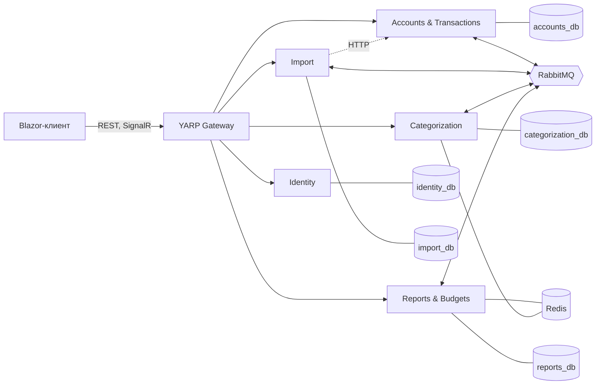
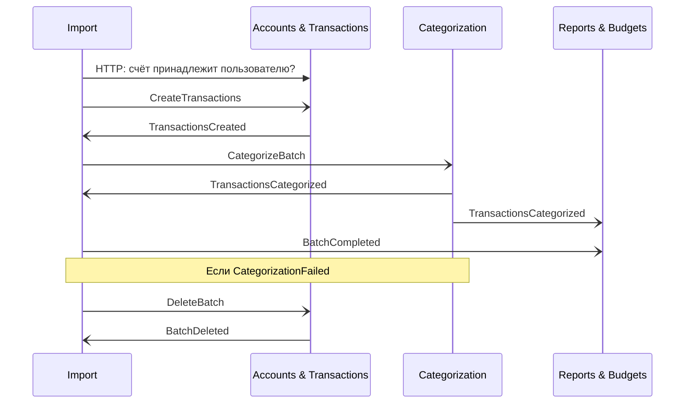

# Архитектура системы

## 1. Цель и контекст

Система для учёта личных финансов. Пользователь ведёт счета и операции, загружает банковские выписки в CSV, операции сами раскладываются по категориям, можно задать бюджеты на категории и смотреть отчёты.

Пользователи: User (свои данные) и Admin (управляет ролями пользователей).

Основные сценарии:
1. Регистрация и вход.
2. Создание счёта и ручной ввод операций.
3. Импорт выписки: загрузка CSV, создание операций, категоризация, пересчёт бюджетов.
4. Настройка категорий и правил.
5. Бюджеты и уведомление о превышении лимита.
6. Отчёты по категориям и месяцам.

## 2. Требования

- У каждого сервиса своя БД, в чужую БД никто не ходит.
- Если импорт упал на любом шаге, пакет откатывается (Saga с компенсацией).
- Сообщения не должны теряться (Outbox), повторное сообщение не должно давать двойного эффекта (идемпотентность).
- Повторная загрузка той же выписки не создаёт дублей.
- Прогресс импорта и уведомления о бюджете приходят клиенту сразу (SignalR).
- Вся система запускается командой `docker compose up --build`.

## 3. Общая схема

Клиент работает только с Gateway. Сервисы снаружи недоступны.

## 4. Описание сервисов

**Identity.** Регистрация, вход, JWT, refresh-токены, роли.
API: `POST /api/auth/register|login|refresh|logout`, `GET /api/users/me`, для Admin `GET /api/users`, `PUT /api/users/{id}/role`.
БД: users, refresh_tokens. События не использует.

**Accounts & Transactions.** Счета и операции, защита от дублей по хэшу, Outbox.
API: `/api/accounts`, `/api/accounts/{id}/transactions`, `/api/transactions/{id}`, внутренний `GET /internal/accounts/{id}?userId=`.
БД: accounts, transactions, outbox, processed_messages.
Получает: `CreateTransactions`, `DeleteBatch`, `TransactionsCategorized`. Публикует: `TransactionsCreated`, `TransactionsCreationFailed`, `BatchDeleted`.

**Import.** Разбор CSV разных банков, оркестратор Saga, Outbox.
API: `POST /api/imports`, `GET /api/imports`, `GET /api/imports/{id}`.
БД: import_batches, saga_state, outbox, processed_messages.
Получает: `TransactionsCreated`, `TransactionsCreationFailed`, `TransactionsCategorized`, `CategorizationFailed`, `BatchDeleted`. Публикует: `CreateTransactions`, `CategorizeBatch`, `DeleteBatch`, `ImportStatusChanged`, `BatchCompleted`.

**Categorization.** Категории, правила (подстрока или regex, приоритет), автокатегоризация.
API: `/api/categories`, `/api/rules`, `POST /api/rules/preview`.
БД: categories, rules, processed_messages. Правила кэшируются в Redis.
Получает: `CategorizeBatch`. Публикует: `TransactionsCategorized`, `CategorizationFailed`.

**Reports & Budgets.** Бюджеты, агрегаты, отчёты, SignalR-хаб.
API: `/api/budgets`, `GET /api/reports/by-category`, `GET /api/reports/monthly`, хаб `/hubs/notifications`.
БД: budgets, aggregates, processed_messages. Отчёты кэшируются в Redis.
Получает: `TransactionsCategorized`, `ImportStatusChanged`, `BatchCompleted`. Публикует: `BudgetExceeded`.

**Gateway (YARP).** Маршрутизация запросов к сервисам и проверка JWT.

## 5. Модель данных

| Сервис | Таблицы (основные поля) |
|--------|-------------------------|
| Identity | users (id, email, password_hash, role), refresh_tokens (id, user_id, token_hash, expires_at, revoked) |
| Accounts & Transactions | accounts (id, user_id, name, currency), transactions (id, account_id, batch_id, date, amount, description, hash, category_id), outbox, processed_messages |
| Import | import_batches (id, user_id, account_id, format, status, error), saga_state (batch_id, step, updated_at), outbox, processed_messages |
| Categorization | categories (id, user_id, name), rules (id, category_id, pattern, is_regex, priority), processed_messages |
| Reports & Budgets | budgets (id, user_id, category_id, monthly_limit), aggregates (user_id, category_id, month, total), processed_messages |

Связи между сервисами хранятся просто как идентификаторы, внешних ключей между БД нет.

## 6. Взаимодействие сервисов

Синхронно (HTTP): клиент → Gateway → сервис, а также Import → Accounts & Transactions (проверить, что счёт принадлежит пользователю).

Асинхронно (RabbitMQ):

| Сообщение | Публикует | Получают |
|-----------|-----------|----------|
| `CreateTransactions` (команда) | Import | Accounts & Transactions |
| `TransactionsCreated` | Accounts & Transactions | Import |
| `TransactionsCreationFailed` | Accounts & Transactions | Import |
| `CategorizeBatch` (команда) | Import | Categorization |
| `TransactionsCategorized` | Categorization | Import, Accounts & Transactions, Reports & Budgets |
| `CategorizationFailed` | Categorization | Import |
| `DeleteBatch` (команда) | Import | Accounts & Transactions |
| `BatchDeleted` | Accounts & Transactions | Import |
| `ImportStatusChanged` | Import | Reports & Budgets |
| `BatchCompleted` | Import | Reports & Budgets |
| `BudgetExceeded` | Reports & Budgets | Reports & Budgets |

### Saga импорта

Оркестратор находится в сервисе Import.

Порядок работы:
1. Клиент загружает CSV, Import проверяет счёт, разбирает файл, статус `Parsed`.
2. Команда `CreateTransactions`, потом `TransactionsCreated`.
3. Команда `CategorizeBatch`, потом `TransactionsCategorized`.
4. Reports обновляет агрегаты и проверяет лимиты, при превышении публикует `BudgetExceeded` и шлёт уведомление через SignalR.
5. Import ставит статус `Completed` и публикует `BatchCompleted`.

Если сбой на шаге 2 или 3, Import отправляет `DeleteBatch`, после `BatchDeleted` ставит статус `Failed`, пользователь получает уведомление. Шаг, который не ответил за таймаут, тоже считается сбоем. На каждом шаге Import публикует `ImportStatusChanged`, из него клиент получает прогресс.

### Надёжность
- Outbox: в Accounts & Transactions и Import сообщение записывается в таблицу `outbox` в одной транзакции с данными, потом фоновый воркер отправляет его в RabbitMQ.
- Идемпотентность: id обработанных сообщений хранится в `processed_messages`, повторное сообщение пропускается.
- Дубли операций: уникальный хэш (счёт, дата, сумма, описание, порядковый номер среди одинаковых строк выписки).
- Redis: кэш отчётов (категория и месяц) с версией в ключе, версия растёт при `TransactionsCategorized`. Кэш правил категоризации сбрасывается при изменении правил.

## 7. Безопасность

- Пароли хранятся в виде хэша (PasswordHasher из ASP.NET Identity).
- Access-токен JWT живёт 15 минут, refresh-токены хранятся хэшем и меняются при обновлении.
- Роли User и Admin, права проверяются на сервере. Пользователь видит только свои данные (по `user_id` из токена).
- JWT проверяется на Gateway и ещё раз в сервисах.
- Наружу открыты только Gateway и клиент.
- Секреты берутся из переменных окружения, в репозитории только `.env.example`.

## 8. Развёртывание и конфигурация

Запуск: `docker compose up --build`. В Compose: по одной БД PostgreSQL на сервис, RabbitMQ, Redis, 5 сервисов, Gateway и клиент.

Порты на хосте (уточню при настройке): клиент 8081, Gateway 8080, панель RabbitMQ 15672.

Также: логи через Serilog с `X-Correlation-Id`, `/health` в каждом сервисе, Swagger, миграции EF Core при старте, начальные данные (тестовые пользователи и категории). Тесты: xUnit, интеграционные через Testcontainers. CI: GitHub Actions.

## 9. Принятые решения

**ADR-1. Оркестрация вместо хореографии.** Импорт ведёт один оркестратор в Import. Альтернатива: хореография. Процесс линейный, с откатом, так проще отлаживать и показывать прогресс. Минус: Import знает все шаги.

**ADR-2. Outbox.** Данные и сообщение пишутся в одной транзакции. Альтернативы: публикация сразу после коммита, распределённая транзакция. Так сообщение не теряется при падении. Минус: возможны повторы, поэтому нужна идемпотентность.

**ADR-3. Saga и Outbox вручную, без MassTransit.** Альтернатива: MassTransit. Проще объяснить на защите и нет лишней зависимости. Минус: больше кода и тестов.

**ADR-4. Своя БД у каждого сервиса.** Альтернатива: общая БД. Чёткие границы сервисов, этого требует задание. Минус: нет JOIN между сервисами, данные передаются событиями.

**ADR-5. Redis для кэша.** Альтернативы: кэш в памяти, без кэша. Отчёты считаются дорого и читаются часто. Ключи с версией, инвалидация по событию. Минус: данные могут быть немного устаревшими.

**ADR-6. YARP как Gateway, JWT проверяется на Gateway и в сервисах.** Альтернатива: Ocelot, проверка только на Gateway. YARP развивается Microsoft, повторная проверка в сервисах безопаснее. Минус: у всех сервисов общий ключ подписи.

**ADR-7. Дедупликация по хэшу.** Альтернативы: id операции из банка (его нет в некоторых форматах), уникальный индекс по полям. Минус: если в выписке изменится порядок одинаковых строк, порядковый номер может не совпасть.

**ADR-8. Один синхронный вызов Import → Accounts.** Альтернатива: доверять `accountId` из запроса. Нужно сразу отказать пользователю, если счёт чужой, а не падать посередине Saga. Минус: Import зависит от доступности Accounts.

**ADR-9. SignalR-хаб в Reports & Budgets.** Альтернатива: отдельный сервис уведомлений. Не хочу плодить шестой сервис при коротком сроке. Минус: Reports отвечает ещё и за уведомления.

## 10. Ограничения и развитие

- Категоризация только по правилам, без ML.
- Одна валюта на счёт, без конвертации.
- Один экземпляр RabbitMQ и Redis, без кластера.
- Общий симметричный ключ подписи JWT, без ротации.
- Можно добавить: прогноз расходов, поиск повторяющихся платежей, отдельный сервис уведомлений.

Документ описывает задуманную архитектуру, при расхождениях с реализацией буду его исправлять.
